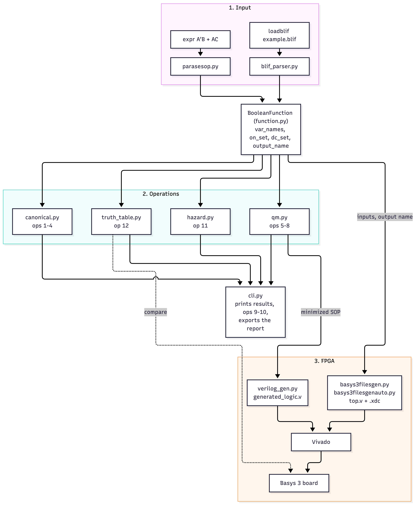
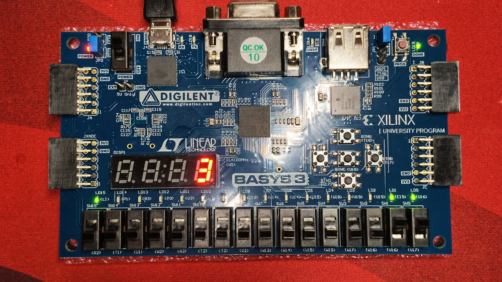
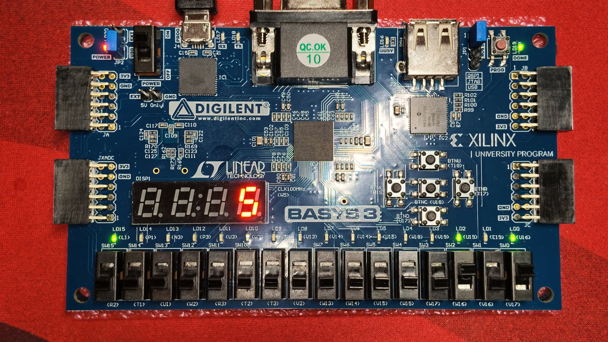
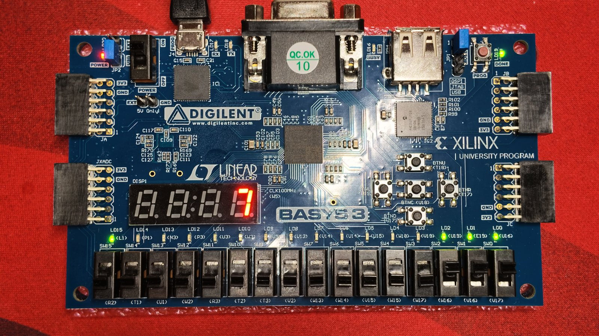
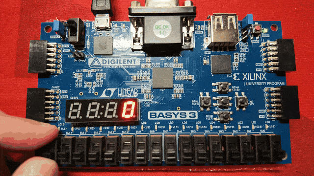

# EC551 Logic Synthesis Engine


[](https://github.com/RichardLitt/standard-readme)

A Python logic synthesis engine that minimizes Boolean functions and runs them on a Basys 3 FPGA as structural Verilog.

This is Programming Assignment 1 for EC551, Advanced Digital Design with Verilog
and FPGAs (Boston University, Fall 2026, Prof. Douglas Densmore). The engine
reads a Boolean function, either typed as an SOP expression or loaded from a
BLIF file (a single SOP block or a multi-level gate circuit), and then:

- prints the canonical SOP/POS forms of the function and of its inverse,
- minimizes it with the Quine-McCluskey algorithm and reports the literal savings,
- counts prime implicants, essential prime implicants, ON-set and OFF-set terms,
- detects static hazards and prints a truth table (our two custom commands),
- generates a structural Verilog module plus the Basys 3 wrapper and pin
  constraints, so the minimized circuit can be synthesized and run on the board.

## Table of Contents

- [Security](#security)
- [Background](#background)
- [Install](#install)
- [Usage](#usage)
  - [Load a function](#load-a-function)
  - [Commands](#commands)
  - [Example session](#example-session)
  - [BLIF input format](#blif-input-format)
- [FPGA Deployment](#fpga-deployment)
- [Demo Results](#demo-results)
- [Repository Structure](#repository-structure)
- [Known Limitations](#known-limitations)
- [AI Usage](#ai-usage)
- [API](#api)
- [Maintainers](#maintainers)
- [Thanks](#thanks)
- [Contributing](#contributing)
- [License](#license)

## Security

The engine runs entirely on your own computer and never uses the network. It
only reads the expression or BLIF file you give it, and only writes files into
`fpga/` (Verilog, wrapper, constraints) and `reports/` (exported report).

## Background

Our goal was to build a small but complete logic synthesis flow, from a Boolean
function on paper to a working circuit on a real FPGA, in code we can read and
explain end to end. Concretely, we wanted the engine to:

- accept a function the way designers actually write it: as a Boolean
  expression, or as a gate-level netlist in a standard EDA format (BLIF);
- find the cheapest two-level implementation exactly, and show how much it saves
  compared with the canonical form;
- go beyond minimization by checking the result for static hazards;
- turn the minimized result into hardware automatically, with no hand-written
  logic between the minimizer and the FPGA.

The engine is organized as a pipeline around one shared data structure:



### Key design decisions

- **One shared data structure.** Both input parsers produce the same
  `BooleanFunction`, so every operation works the same no matter how the
  function was entered.
- **Cubes as strings.** A product term is a string of `0`, `1` and `-`, one
  character per variable, e.g. `"0-1"` = A'C. `var_names[0]` is the most
  significant bit, so minterm 6 with variables A, B, C is `110`.
- **Operations return data, the CLI formats it.** For example `minimize_sop(f)`
  returns `["01-", "1-1"]`; `cli.py` prints it as `A'B + AC`, and
  `verilog_gen.py` turns the same list into gates.
- **Exact two-level minimization.** Quine-McCluskey finds every prime implicant
  by repeatedly merging cubes that differ in one bit. The cover takes all
  essential primes first, then searches the remaining primes from the smallest
  set upward and keeps the one with the fewest literals. Minimized POS is the
  minimized SOP of F', read back as sum terms.
- **BLIF by simulation.** The BLIF parser evaluates the circuit for every input
  combination, so a single `.names` block (SOP) and a multi-level circuit with
  internal signals are handled by the same code.
- **Static hazard detection.** A static-1 hazard exists when two adjacent ON
  minterms (differing in one input) are not covered by the same product term.
  Static-0 hazards are found the same way on the OFF-set of the minimized POS.
- **Generated FPGA files.** The Verilog module, the top-level wrapper and the
  pin constraints are all produced by Python from the loaded function, so a new
  function only needs a new bitstream, not new hand-written HDL.

## Install

Requirements:

- Python 3.8 or newer. Only the standard library is used, so there is nothing
  else to install. Tested with Python 3.10 and 3.13.
- For the FPGA part: AMD Vivado and a Digilent Basys 3 board.

```bash
git clone https://github.com/ianpeng-hw/Ec551-Logic-Synthesis-Engine.git
cd Ec551-Logic-Synthesis-Engine
```

Nothing needs to be compiled.

## Usage

Start the interactive shell from the repository folder (example paths and
generated files are relative to it):

```bash
python3 main.py          # on Windows: python main.py
```

Type `help` to list the commands and `quit` to exit.

### Load a function

Load a function first; every other command works on the most recently loaded one.

| Command | Example | Notes |
|---|---|---|
| `expr <SOP>` | `expr A'B + AC` | Variables are single letters A-Z, `'` means NOT, `+` separates product terms. No spaces inside a term. The output is named `out`. |
| `loadblif <file>` | `loadblif examples/example.blif` | Reads a BLIF file; the output name comes from `.outputs`. |

### Commands

| # | Operation | Command |
|---|---|---|
| 1 | Canonical SOP | `sop` |
| 2 | Canonical POS | `pos` |
| 3 | Inverse canonical SOP | `invsop` |
| 4 | Inverse canonical POS | `invpos` |
| 5 | Minimized SOP + literals saved vs. canonical SOP | `minsop` |
| 6 | Minimized POS + literals saved vs. canonical POS | `minpos` |
| 7 | Number of prime implicants | `primeim` |
| 8 | Number of essential prime implicants | `essentialpi` |
| 9 | Number of ON-set minterms | `oncount` |
| 10 | Number of OFF-set maxterms | `offcount` |
| 11 | Custom #1: static hazard detection (SOP and POS) | `hazard` |
| 12 | Custom #2: truth table | `truth` |
| - | Export all results above to a text file | `loadoutputs [file]` (default `reports/synthesisreport.txt`) |
| - | Generate structural Verilog only | `verilog` |
| - | Generate Verilog + Basys 3 files, manual input | `fpga` |
| - | Generate Verilog + Basys 3 files, manual/automatic sweep | `fpgaauto` |

### Example session

```
> loadblif examples/example.blif
BLIF circuit loaded successfully.
Variables: ['A', 'B', 'C']
Output: F
ON-set: [2, 3, 5, 7]
OFF-set: [0, 1, 4, 6]
> sop
Canonical SOP: A'BC' + A'BC + AB'C + ABC
> pos
Canonical POS: (A + B + C)(A + B + C')(A' + B + C)(A' + B' + C)
> minsop
Minimized SOP: A'B + AC
Canonical SOP literals: 12
Minimized SOP literals: 4
Literals saved: 8
> minpos
Minimized POS: (A + B)(A' + C)
Canonical POS literals: 12
Minimized POS literals: 4
Literals saved: 8
> primeim
Prime Implicant count: 3
> essentialpi
Essential Prime Implicant count: 2
> hazard
SOP Static-1 Hazards:
  A changes while B=1, C=1  (m3 <-> m7)
POS Static-0 Hazards:
  A changes while B=0, C=0  (m0 <-> m4)
> truth
m | A B C | F
-------------
0 | 0 0 0 | 0
1 | 0 0 1 | 0
2 | 0 1 0 | 1
3 | 0 1 1 | 1
4 | 1 0 0 | 0
5 | 1 0 1 | 1
6 | 1 1 0 | 0
7 | 1 1 1 | 1
```

### BLIF input format

```
.model example
.inputs A B C
.outputs F

.names A B N1
01 1

.names A C N2
11 1

.names N1 N2 F
1- 1
-1 1

.end
```

Each `.names` block is one gate: the last name is its output and each row lists
the input values (`-` = either) for which the output is 1. Blocks connected
through internal signals (`N1`, `N2` above) describe a multi-level circuit; a
single block describes an SOP. Supported subset: combinational logic only (no
`.latch` / `.subckt`), one output, rows ending in `1`. Comments (`#`) and line
continuation (`\`) are allowed.

## FPGA Deployment

### 1. Generate the files

```
> loadblif examples/example.blif
> fpgaauto
```

| Command | Files written to `fpga/` | Top module |
|---|---|---|
| `fpgaauto` | `generated_logic_auto.v`, `top_auto.v`, `basys3_auto.xdc` | `top_auto` |
| `fpga` | `generated_logic.v`, `top.v`, `basys3.xdc` | `top` |

`generated_logic*.v` holds the minimized circuit (module `structurallogic`,
built from `and`, `or`, `not` and `buf` primitives). `top*.v` is the wrapper
that connects it to the board, and the `.xdc` file maps the ports to the
board's pins.

### 2. Build in Vivado

1. Create an RTL project and choose the part **xc7a35tcpg236-1**.
2. Add the generated `.v` file and the matching `top*.v` as design sources,
   and the matching `.xdc` file as a constraint.
3. Make sure the wrapper (`top_auto` or `top`) is set as the top module.
4. Generate Bitstream, then Open Hardware Manager -> Open Target ->
   Auto Connect -> Program Device.

### 3. Board mapping

**Automatic version (`fpgaauto`, 1 to 14 inputs)**

| Board | Function |
|---|---|
| SW15 | Mode: down = manual, up = automatic |
| SW(N-1) ... SW0 | Manual inputs, first variable on the left (MSB), so the switches read as the minterm number |
| LD15 | Output F |
| LD14 | On in automatic mode |
| LD(N-1) ... LD0 | Current input combination |
| 7-segment display | Current minterm number (hexadecimal) |

In automatic mode a counter driven by the 100 MHz board clock steps through all
2^N input combinations, one per second, starting from 0 each time SW15 is
switched up. The board plays the whole truth table by itself, so each step can
be checked against the `truth` command, even when the input space is too large
to set by hand.

**Manual version (`fpga`, 1 to 16 inputs)**

| Board | Function |
|---|---|
| SW0 ... SW(N-1) | Inputs, first variable on SW0 |
| LD0 | Output F |
| 7-segment display | Shows 1 or 0 for F |

## Demo Results

`examples/example.blif` (F = A'B + AC) running on a Basys 3 with the automatic
version (`fpgaauto`), in manual mode (SW15 down). The inputs A B C are set on
SW2 SW1 SW0. The four photos are the ON-set of the function, m = 2, 3, 5, 7,
which is the same result the `truth` and `minsop` commands give.

<table>
  <tr>
    <td align="center"><br>
      A B C = 0 1 0: display shows 2, LD15 (F) on</td>
    <td align="center"><br>
      A B C = 0 1 1: display shows 3, LD15 (F) on</td>
  </tr>
  <tr>
    <td align="center"><br>
      A B C = 1 0 1: display shows 5, LD15 (F) on</td>
    <td align="center"><br>
      A B C = 1 1 1: display shows 7, LD15 (F) on</td>
  </tr>
</table>

**Automatic mode (SW15 up):** the board steps through m = 0 to 7, one per
second, and plays the whole truth table by itself. LD15 (F) turns on at
m = 2, 3, 5, 7 and stays off at m = 0, 1, 4, 6.

<p align="center">
  
</p>

A full report produced by `loadoutputs` is in
[reports/synthesisreport.txt](reports/synthesisreport.txt).

## Repository Structure

```
Ec551-Logic-Synthesis-Engine/
├── main.py                    # entry point: starts the interactive CLI
├── synth/
│   ├── function.py            # BooleanFunction class + shared cube helpers
│   ├── parasesop.py           # input: typed SOP expressions
│   ├── blif_parser.py         # input: .blif files (SOP or multi-level)
│   ├── canonical.py           # ops 1-4: canonical SOP/POS and inverses
│   ├── qm.py                  # ops 5-8: Quine-McCluskey, PIs, EPIs, min SOP/POS
│   ├── hazard.py              # op 11: static-1 / static-0 hazard detection
│   ├── truth_table.py         # op 12: truth table
│   ├── verilog_gen.py         # structural Verilog generation
│   ├── basys3filesgen.py      # Basys 3 wrapper + pins, manual switch input
│   ├── basys3filesgenauto.py  # Basys 3 wrapper + pins, manual/automatic sweep
│   └── cli.py                 # interactive command shell and report export
├── docs/
│   ├── ec551_pa1_diagram.png  # architecture diagram used in this README
│   ├── demo_m*.jpg            # photos of the design running on the Basys 3 (manual mode)
│   └── fpga_auto.gif          # the board in automatic mode
├── examples/
│   └── example.blif           # demo input: F = A'B + AC as a gate-level circuit
├── fpga/                      # generated Verilog, wrapper and constraints
├── reports/
│   └── synthesisreport.txt    # sample output of the loadoutputs command
└── README.md
```

## Known Limitations

- Minimization is exact, so its run time grows quickly with the number of
  variables. Functions with up to about 5 inputs run instantly; larger
  irregular functions can take noticeably longer.
- One output per function. The BLIF reader supports the combinational subset
  described above.
- Typed expressions use single-letter variable names.
- Load a function before running the other commands.
- Hazard glitches last nanoseconds and Vivado maps the logic into LUTs, so
  hazards are reported by the `hazard` command rather than shown on the board.

## AI Usage

As allowed by the course AI policy, we used generative AI tools. We reviewed,
edited and tested all of this code and can explain every part of it.

- **Claude (Anthropic)**, used by Ian. The functions in `qm.py` and `hazard.py`
  are marked in the code with `"""I use AI here"""`.
  - `qm.py`, `minimize_sop()`: an earlier version tried every combination of all
    prime implicants and never finished on a 6-input parity function. Claude
    explained why the cover should take the essential prime implicants first
    and then search only the primes that still cover an uncovered minterm, and
    provided the code for this version.
  - `hazard.py`, `add_covers()`: Claude explained how to remove a hazard by
    adding one prime implicant that covers both minterms of an uncovered
    adjacent pair, and corrected our version (it used `or` instead of `and` and
    added duplicate terms).
  - `hazard.py`, `hazard_free_pos()`: Claude explained that the extra terms
    must come from the prime implicants of F', and corrected our version.
  - `hazard.py`, `describe_hazard()`: Claude wrote this function, which turns a
    hazard into readable text.
  - `blif_parser.py`: written by Claude; we reviewed and tested it and can
    explain how it works.
  - This README was drafted with Claude.
- **ChatGPT (OpenAI)**, used by Aoke Huang. These parts are marked with
  comments in the code.
  - `basys3filesgen.py`: ChatGPT helped write the Python function that
    automatically generates the Basys 3 top-level Verilog wrapper (`top.v`)
    and pin constraints (`basys3.xdc`) based on the number of Boolean input
    variables. We reviewed and tested the generated files using Vivado and the
    Basys 3 FPGA.
  - `basys3filesgenauto.py`: ChatGPT helped create the automatic FPGA file
    generator, including the top-level wrapper for manual and automatic
    truth-table testing, clock-based counting, and switch, LED, and
    seven-segment display mappings.
  - `cli.py` (report export): ChatGPT helped implement the command that exports
    the synthesis results to a text file, including canonical and minimized
    expressions, prime implicants, literal counts, hazard information, truth
    tables, and structural Verilog.
  - `cli.py` (hazard command): ChatGPT helped integrate the existing
    hazard-detection functions into the command-line interface so users can
    display potential static-1 and static-0 hazards.
  - We reviewed, edited, and tested the AI-assisted code and integrated it with
    the rest of our Logic Synthesis Engine.

## API

The modules can also be used from Python without the CLI. Every function takes a
`BooleanFunction`; cube lists use the `"0-1"` string format described in
[Background](#key-design-decisions).

```python
from synth.blif_parser import read_blif
from synth.qm import minimize_sop
from synth.function import sop_to_string

f = read_blif("examples/example.blif")
print(sop_to_string(minimize_sop(f), f.var_names))   # A'B + AC
```

| Module | Function | Returns |
|---|---|---|
| `function.py` | `BooleanFunction(var_names, on_set, dc_set=set(), output_name="F")` | the shared function object; `f.off_set()` returns the OFF-set |
| `function.py` | `sop_to_string(cubes, var_names)`, `pos_to_string(cubes, var_names)` | expression text |
| `blif_parser.py` | `read_blif(filename)` | `BooleanFunction` |
| `parasesop.py` | `parseexpression(expr)`, `getvariables(terms)`, `minterms(terms, variables)` | parsed terms, sorted variable list, ON-set |
| `canonical.py` | `canonicalsop(f)`, `canonicalpos(f)`, `inversecanonicalsop(f)`, `inversecanonicalpos(f)` | expression text |
| `qm.py` | `minimize_sop(f)`, `minimize_pos(f)` | list of cubes |
| `qm.py` | `PI(f)`, `EPI(f)` | list of cubes |
| `hazard.py` | `find_hazardSOP(f)`, `find_hazardPOS(f)` | list of `(a, b, cube)` hazards |
| `hazard.py` | `hazard_free_sop(f)`, `hazard_free_pos(f)` | list of cubes with the covering terms added |
| `hazard.py` | `describe_hazard(hazard, var_names)` | text such as `A changes while B=1, C=1  (m3 <-> m7)` |
| `truth_table.py` | `truthtable(f)` | truth table text |
| `verilog_gen.py` | `generate_verilog(f, filepath="fpga/generated_logic.v")` | path of the written `.v` file |
| `basys3filesgen.py` | `generate_basys3_files(f, folder="fpga")` | `(top_path, xdc_path)` |
| `basys3filesgenauto.py` | `generate_basys3_auto_files(f, folder="fpga")` | `(top_path, xdc_path)` |

## Maintainers

- Ian Peng ([@ianpeng-hw](https://github.com/ianpeng-hw))
- Aoke Huang ([@ahc9701-wq](https://github.com/ahc9701-wq))

## Thanks

Thanks to Prof. Douglas Densmore for the assignment and guidance.

## Contributing

This is a course project, so we are not accepting outside contributions. Within
the team we each own separate files, pull before starting work, and push to
`main` (larger features go through pull requests).

If editing this README, please follow the
[standard-readme](https://github.com/RichardLitt/standard-readme) specification.

## License

Coursework for EC551 at Boston University, Fall 2026. No open-source license is
granted; all rights reserved by the authors.
